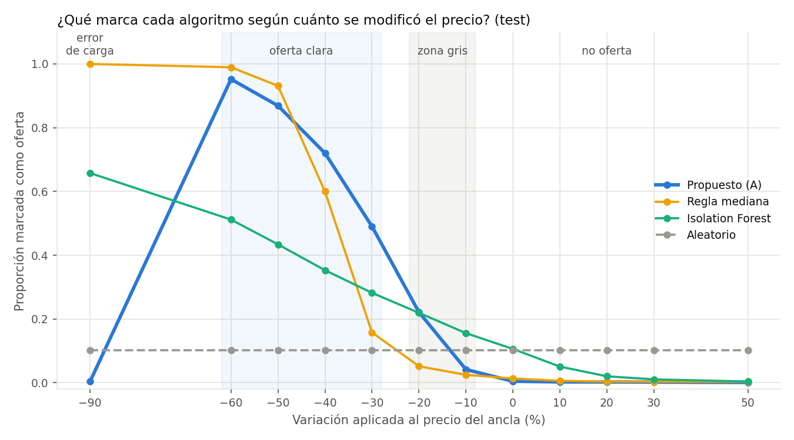

# TP3 — Reporte final

Grupo 1 — Camila Ines Amado, Francisco Risculese, Agustin Macrina y Lucila Pasquetta

## Pregunta de análisis
Dado un precio de hotel en un contexto (destino, fecha, ocupación), ¿es inusualmente bajo para su mercado? ¿Qué algoritmo lo
decide mejor?

## Conclusión ejecutiva
Se elige un **detector robusto por destino × mes**: compara el log-precio contra la mediana y el MAD de 2024 en su contexto,
marca oferta si está 1,5 desvíos robustos por debajo y al menos 20% más barato, separa como *sospechoso* lo que está 80% por
debajo (probable error de carga) y, si falta historial, baja a destino → país × mes → país. En test logra **precisión 0,996,
recall 0,76, F1 0,86 y 0,3% de falsos positivos**, con 99,8% de cobertura. Supera a la regla de mediana
y a Isolation Forest, y de los cuatro modelos es el único que no recomienda errores de carga. Se expone con una API
FastAPI en Docker.

## Diseño de la evaluación
- **Train = 2024.** Los modelos no ven nada de 2025 (tampoco los cortes de `price_bucket`).
- **2025 en tres pools disjuntos** por destino × fecha de check-in: *mercado* (verdad), *val* (umbrales), *test* (comparación final).
- **Test:** 3.000 precios normales (±10% de la mediana de mercado 2025), estratificados por volumen del destino, trimestre y nivel
  de precio, con variaciones de −90% a +50% → 27.000 casos etiquetados, 6.000 en zona gris, 3.000 errores de carga; más 20.000
  búsquedas reales sin tocar.
- **Umbral de cada modelo:** el de mayor F1 en validación sin marcar más del 10% de los precios reales.

## Métricas elegidas
Precisión (confianza del usuario), recall (no perder ofertas), F1 (para elegir), tasa de falsos positivos (independiente de la
proporción de ofertas del test), cobertura (que no gane absteniéndose), alertas en reales y errores de carga marcados como oferta
(costo operativo). Accuracy no se usa para decidir: depende del diseño del test.

## Evidencia principal

| Algoritmo | Accuracy | Precisión | Recall | F1 | FPR | Errores de carga → oferta |
|---|---|---|---|---|---|---|
| **Propuesto (A)** | 0,891 | 0,996 | 0,758 | **0,861** | 0,3% | **0,4%** |
| Regla de mediana | 0,850 | 0,989 | 0,670 | 0,798 | 0,6% | 100% |
| Isolation Forest | 0,710 | 0,892 | 0,395 | 0,548 | 3,8% | 65,8% |
| Aleatorio | 0,544 | 0,444 | 0,102 | 0,166 | 10,2% | 10,2% |

Ponderando cada caso por su demanda (`count_repeated`) el ranking se mantiene: propuesto F1 0,89, regla de mediana 0,81, Isolation Forest 0,45.

## Política de decisión
Se prioriza **precisión sobre recall** (decisión explícita): con `z_cut = −1,5` casi nunca se marca como oferta un precio
normal (0,3% de falsos positivos; 0,2% de los precios con +30%), a costa de no ver rebajas chicas (detecta 49% de las de −30% y
22% de las de −20%; el descuento mínimo confiable ronda 33%). Con `z_cut = −1,0` detectaría 88%, pero marcaría 16% de los precios
reales como oferta.

## Dónde falla
- **Rebajas de 30%:** detecta 49%. Con el MAD típico de un mercado (0,18 en log) el descuento mínimo detectable ronda 33%.
- **Mercados caros:** recall 0,56–0,63 vs 0,88–0,91 en baratos (más mezcla de gamas de hotel; falta la categoría).
- **Fallback a país:** recall 0,62 y FPR 2,8% → la API lo informa como `confianza = baja`.
- **Destinos nuevos o con poco historial** y ocupaciones de 3+ personas por habitación.

## Qué cambia respecto del TP2
| Tema | TP2 | TP3 | Por qué |
|---|---|---|---|
| Escenario de mercado | B: destino × mes × `price_bucket` | **A: destino × mes** (B se sigue evaluando) | La ventaja de B (menos dispersión, 69,9% de "Deal" ante −20% vs 45,6% en A) tiene una limitación conocida: el bucket sale del mismo precio evaluado, así que una rebaja puede cambiar de gama. Comparando directamente con y sin bucket en el mismo test, B detecta menos (recall 0,73 vs 0,76). |
| Unidad de análisis | noche pagada | **búsqueda**, contexto = mes de check-in | La decisión es por consulta; expandir repetía el precio e inflaba el soporte. Solo 5,8% de las estadías cruza de mes. |
| Precio comparable | precio / (noches × habitaciones × personas) | **`avg_price_average`** (habitación-noche) | Elasticidad del precio a noches ≈ 0,05 y a habitaciones ≈ 0,02: ya viene normalizado. Dividir por noches × habitaciones × personas en todas las filas deja casi ciegos a los modelos (F1 del propuesto 0,28). Además, el código del repo (`standardize_prices`), por un error, solo dividía el 5% de las filas: mezclaba dos unidades. |
| Mapeo de destinos | función del repo: 28–36% de match | **lógica de referencia del repo**: 69% filas / 81% demanda | Corrige mayúsculas, claves de 2 partes, alias de EE.UU.; deja `match_level`. |
| `count_repeated` | peso de demanda en baselines | referencias sin ponderar + **métricas ponderadas por demanda** como chequeo | Soporte = cantidad de búsquedas (todas se conservan); ponderado, el propuesto da F1 0,89 y el ranking no cambia. |

## Otros modelos que se probaron (anexo)
Variantes del propuesto con una pieza cambiada; no compiten por la elección:
- **MAD puro** (sin reglas de negocio): F1 0,86, igual detección, pero marca como oferta el 100% de los errores de carga.
- **Con `price_bucket` (B):** F1 0,84; el bucket depende del precio evaluado (limitación declarada).
- **v1 con piso absoluto:** F1 0,81, castiga mercados baratos.
- **z-score del grupo** (media/desvío): F1 0,84, el triple de falsos positivos, recomienda el 95% de los errores de carga y deja 14% sin decidir.

## Decisiones descartadas
- **Isolation Forest:** confunde "combinación rara" (8+ noches, ocupación poco común) con "precio bajo"; FPR 3,8%.
- **`price_bucket` (Escenario B):** no es un error, es una limitación: el precio rebajado puede cambiar de bucket. Comparado directamente, resta recall (0,73 vs 0,76).
- **Piso absoluto global para sospechosos (v1):** castigaba mercados baratos (recall 0,58 → 0,91 al quitarlo).
- **Precio /(noches × habitaciones × personas):** `avg_price_average` ya viene por habitación-noche; esa fórmula triplica la
  dispersión y deja a todos los modelos casi ciegos (F1 del propuesto 0,28). Además, el código del repo, por un error, solo dividía
  el 5% de las filas (mezclaba dos unidades).
- **Eliminar datos:** no se borran duplicados ni extremos (los filtros de validez no descartan ninguna fila). Los extremos se
  manejan con mediana/MAD, que no se dejan arrastrar por un precio absurdo, y la regla de "sospechoso".
- **Expansión a noches:** repetía el mismo precio y no aporta para decidir por consulta.
- **Separar el contexto por duración (destino × mes × grupo de noches):** se usa `avg_price_average`
  sin dividir, en una sola unidad para todo el pipeline, y se probó no mezclar duraciones. Dentro de cada destino × mes el precio
  por noche cambia menos de 1,1% entre 1, 2–3, 4–6 y 7+ noches, y el F1 queda igual (0,862 vs 0,861, IC superpuestos).
  Se mantiene destino × mes, que tiene más historial por contexto.

## Cobertura y confianza
Mapeo de destinos sobre el histórico completo 2024 + 2025: 69,0% de las filas, 80,5% de la demanda, 35,6% de las geografías únicas (lo no mapeado cae al fallback por país). La muestra del 20% por año difiere del total en menos de 0,1 pp por mes, país y destino.
99,8% de las búsquedas reales de 2025 reciben decisión. Con nivel destino × mes (confianza alta): 57% de las anclas de test;
destino: 38%; país × mes: 5%. Lo que no tiene soporte devuelve `sin_soporte` sin romper. Cada respuesta informa cuántas
búsquedas sostienen la referencia (`n_referencia`), cuánta demanda representan (`demanda_referencia`) y las `noches` de la consulta.

## Limitaciones
Sin etiquetas reales (las ofertas son rebajas artificiales); sin categoría de hotel; el contexto no controla ocupación;
una sola partición temporal; referencias estáticas; noviembre y diciembre de 2024 tienen muchas menos búsquedas que 2025
(10–21 mil vs 35–37 mil), así que en esos meses las referencias se apoyan en menos destinos (el precio a igual destino no cambia); el cambio de la v1 (piso absoluto) a la versión final se detectó mirando errores en test (se decidió con
validación y se reportan ambas versiones).

## Próximos pasos
Conseguir categoría/estrellas del hotel (es donde más falla el modelo: mercados caros); sumar ocupación al contexto o normalizar por personas con la elasticidad estimada; validar con ofertas reales si aparecen
etiquetas.
